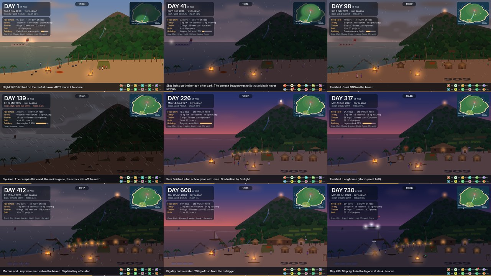

# Castaway Island

**12 castaways · 1,200 acres · 730 days.** A simulated island survival story, rendered as the last 15 seconds of every single day — golden hour sinking into night at the beach camp — for two full years.



*Day 1 the ditching · Day 41 a ship passes in the dark · Day 98 the SOS · Day 139 the cyclone · Day 226 graduation · Day 317 the longhouse · Day 412 a wedding · Day 600 the outrigger · Day 730 rescue*

---

## Watch

| | |
|---|---|
| **Two years in two minutes** | [`videos/two-years-timelapse.mp4`](videos/two-years-timelapse.mp4) — every day, a sixth of a second each, at dusk |
| **The whole thing** | 24 monthly videos below, **3 h 2 min** in total (730 days × 15 s). Open [`videos/castaway-island.m3u`](videos/castaway-island.m3u) in VLC to play them back to back |

| Month | Days | Video |
|---|---|---|
| Nov 2026 | 1–30 | [month-01](videos/month-01_2026-11_days-001-030.mp4) — the ditching, the lean-to, fishing gear, the summit |
| Dec 2026 | 31–61 | [month-02](videos/month-02_2026-12_days-031-061.mp4) — the beacon dies, **the missed ship (day 41)**, night watch |
| Jan 2027 | 62–92 | [month-03](videos/month-03_2027-01_days-062-092.mp4) — first hut, aqueduct, smokehouse |
| Feb 2027 | 93–120 | [month-04](videos/month-04_2027-02_days-093-120.mp4) — SOS, first garden, Sam breaks his arm |
| Mar 2027 | 121–151 | [month-05](videos/month-05_2027-03_days-121-151.mp4) — **the cyclone (day 139)** and the rebuild |
| Apr 2027 | 152–181 | [month-06](videos/month-06_2027-04_days-152-181.mp4) — huts 3 and 4 |
| May 2027 | 182–212 | [month-07](videos/month-07_2027-05_days-182-212.mp4) — summit lookout, more gardens |
| Jun 2027 | 213–242 | [month-08](videos/month-08_2027-06_days-213-242.mp4) — classroom, graduation, dugout canoe, infirmary |
| Jul 2027 | 243–273 | [month-09](videos/month-09_2027-07_days-243-273.mp4) — kiln, footbridge |
| Aug 2027 | 274–304 | [month-10](videos/month-10_2027-08_days-274-304.mp4) — tree nursery, replanting begins |
| Sep 2027 | 305–334 | [month-11](videos/month-11_2027-09_days-305-334.mp4) — **the longhouse**, the dock |
| Oct 2027 | 335–365 | [month-12](videos/month-12_2027-10_days-335-365.mp4) — one year |
| Nov 2027 | 366–395 | [month-13](videos/month-13_2027-11_days-366-395.mp4) — a boat turns away (day 388), the bell |
| Dec 2027 | 396–426 | [month-14](videos/month-14_2027-12_days-396-426.mp4) — the outrigger, **a wedding (day 412)** |
| Jan 2028 | 427–457 | [month-15](videos/month-15_2028-01_days-427-457.mp4) |
| Feb 2028 | 458–486 | [month-16](videos/month-16_2028-02_days-458-486.mp4) — second cyclone; the longhouse holds |
| Mar 2028 | 487–517 | [month-17](videos/month-17_2028-03_days-487-517.mp4) — day 500 |
| Apr 2028 | 518–547 | [month-18](videos/month-18_2028-04_days-518-547.mp4) |
| May 2028 | 548–578 | [month-19](videos/month-19_2028-05_days-548-578.mp4) — eighteen months |
| Jun 2028 | 579–608 | [month-20](videos/month-20_2028-06_days-579-608.mp4) |
| Jul 2028 | 609–639 | [month-21](videos/month-21_2028-07_days-609-639.mp4) |
| Aug 2028 | 640–670 | [month-22](videos/month-22_2028-08_days-640-670.mp4) |
| Sep 2028 | 671–700 | [month-23](videos/month-23_2028-09_days-671-700.mp4) |
| Oct 2028 | 701–730 | [month-24](videos/month-24_2028-10_days-701-730.mp4) — the survey plane, the radio drop, **rescue (day 730)** |

On GitHub, click a video and then **View raw** (or download) to play it. To stitch everything into one 3-hour file: `cd videos && ffmpeg -f concat -i concat.txt -c copy castaway-island-full.mp4`

---

## What's in each 15 seconds

Every clip is drawn from that day's simulation state — nothing is repeated from a template.

- **Sky:** the real sunset time and moon phase for the date at 15° S, plus the day's weather — clear, cloudy, rain, squalls, two cyclones — with clouds, stars, moonlight on the water and lightning.
- **Camp:** all 32 building projects appear at their actual progress (posts → frame → walls → thatch) and storm damage (collapsed after the cyclone, patched during repairs). Gardens green up as they mature. Trees disappear nearest-camp-first as timber is felled; saplings appear as the nursery replants. The wreck sits on the reef until the first cyclone drags it off.
- **People:** all twelve walk home from wherever they worked that day — the shore, the forest, the garden terraces, the building site — to sit around the fire. The sick and injured lie under the lean-to. On cyclone nights nobody is outside.
- **HUD:** day counter, date, season, weather and moon; food store, the day's catch, timber, projects built and the one in progress; who did what; an island map whose fog of war clears as they explore; the day's headline; and the roster with every castaway's health.

## The plan

[**PLAN.md**](PLAN.md) — the island, the twelve castaways, the survival priorities, the phased plan with what actually happened on which day, and the food, timber and weather numbers.

[**docs/journal.md**](docs/journal.md) — one line for every one of the 730 days.

[**data/daily_stats.csv**](data/daily_stats.csv) — the day-by-day numbers (food, timber, health, morale, weather, headline). `data/days.json` has the full state the renderer uses.

## How it works

```
src/sim.py         730-day simulation → data/days.json, data/daily_stats.csv, docs/journal.md
src/render.py      procedural renderer (Pillow + NumPy → ffmpeg), one day = 180 frames at 12 fps
src/render_all.py  renders all 24 months in parallel, then the timelapse
```

The simulation is deterministic (seed 1200). Each day it rolls the weather, assigns all twelve people a job based on skills and what the camp needs (more fishers when stores are low, woodcutters only when a project is short of logs, a nurse only when someone is sick), resolves food, spoilage and preservation, advances building projects, applies storm damage, and updates health and morale. Scripted story beats (the missed ship, the cyclones, the wedding, the rescue) sit on top of that.

### Re-render

Needs Python 3.10+, `numpy`, `Pillow` and `ffmpeg` with libx264.

```bash
python3 src/sim.py                                            # rebuild the two years
python3 src/render.py --still 139 0.3 --out day139.png        # one frame (day, 0–1 through the clip)
python3 src/render.py --days 1-30 --out videos/month-01.mp4   # any range of days
python3 src/render_all.py                                     # everything (~1 hour on 2 cores)
```

Video: 854×480, 12 fps, H.264. All artwork is drawn in code; there are no image assets.
