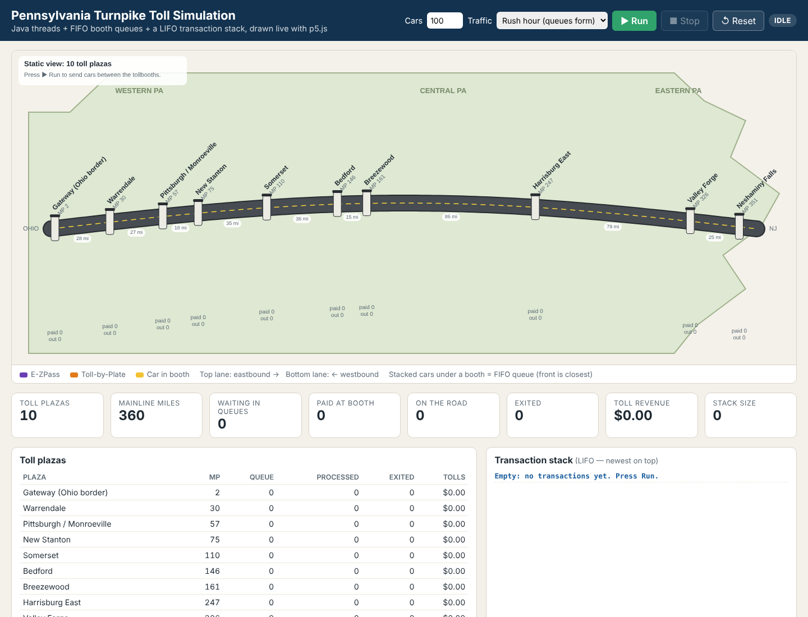
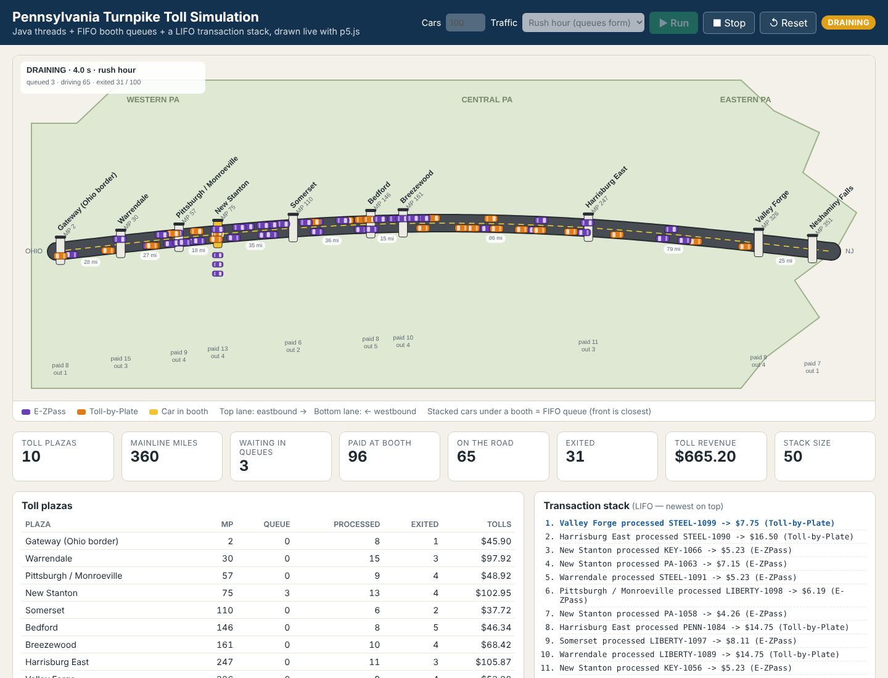

# PA Turnpike Visualizer (Eclipse · Java · p5.js)

A visual version of the multi-threaded **Pennsylvania Turnpike toll simulation**. The Java simulation (car producer threads, toll booth operator threads, FIFO booth queues, and a LIFO transaction stack) runs in the JVM. A p5.js page draws it:

1. **Static view first:** a map of Pennsylvania with the Turnpike, 10 toll plazas at their mileposts, the miles between plazas, and the plaza table.
2. **▶ Run:** cars appear in each booth's queue, get served (the booth turns yellow), then drive in the correct lane to their exit plaza. Counters, revenue, and the LIFO stack update live.

| Static view | Running (rush hour) |
|---|---|
|  |  |

## Import into Eclipse
1. **File → Import → General → Existing Projects into Workspace**.
2. *Select root directory:* this folder (`pa-turnpike-p5-visualizer`). The project **PATurnpikeVisualizer** appears. Click **Finish**.
3. Requires **JDK 17 or newer** (the project uses the `JavaSE-17` execution environment, so any 17+ JDK works). No external libraries, no Maven.

## Run
- **Visualizer:** right-click `src/turnpike/TurnpikeVisualizerServer.java` → **Run As → Java Application**, or use the included `Turnpike Visualizer.launch`.
  Your browser opens **http://localhost:8213/**. If it doesn't, open that address yourself. Press **▶ Run**.
  Stop the server with the red ■ in Eclipse's Console view.
- **Original console version:** run `PennsylvaniaTurnpikeSimulation` (or `Console Simulation.launch`).

Controls on the page:

| Control | What it does |
|---|---|
| **Cars** | Total cars across the three generators (split 18 : 22 : 12 like the original) |
| **Traffic** | *Rush hour* = cars arrive 5× as often, so queues build up. *Normal* = the original arrival timing (200–600 ms) |
| **▶ Run / ■ Stop / ↺ Reset** | Start, freeze, or return to the static view |

Hover any car to see its plate, entry → exit, status, and toll.

## How it works
```
 Browser (p5.js)                     JVM (Eclipse)
 ┌───────────────────┐  GET /api/state  ┌────────────────────────────────┐
 │ sketch.js         │ ───────────────▶ │ TurnpikeVisualizerServer        │
 │  polls every 250ms│ ◀─────────────── │  (JDK built-in HttpServer)      │
 │  draws at 60 fps  │      JSON        │        │                        │
 │                   │  POST /api/run   │  SimulationEngine               │
 └───────────────────┘ ───────────────▶ │   ├─ CarProducerThread ×3       │
                                        │   ├─ TollPlaza ×10 (FIFO queue) │
                                        │   ├─ TollBoothOperatorThread ×10│
                                        │   ├─ TurnpikeTraffic (on road)  │
                                        │   └─ TollTransactionHistory     │
                                        │        (LIFO stack, 50 max)     │
                                        └────────────────────────────────┘
```
The server sends each moving car's trip start time and duration. The sketch computes positions locally from those, so motion stays smooth between polls. Trip time is proportional to distance (25 ms per mile), so a Gateway → Neshaminy Falls trip takes about 9 seconds.

## Files
| File | Role |
|---|---|
| `src/turnpike/Car.java` | Your class, plus id, status (QUEUED / AT_BOOTH / TRAVELING / EXITED) and trip timing |
| `src/turnpike/TollPlaza.java` | Your class, plus milepost, car-in-booth, exited count, toll total, queue snapshot |
| `src/turnpike/TollBoothOperatorThread.java` | Your class; also publishes the car in the booth and hands paid cars to `TurnpikeTraffic` |
| `src/turnpike/CarProducerThread.java` | Your class, plus an optional arrival-speed scale (see the fix below) |
| `src/turnpike/TollTransactionHistory.java` | Bounded LIFO stack (`ArrayDeque`). It was referenced by your code but not included, so it is written here to match how your code uses it |
| `src/turnpike/PennsylvaniaTurnpikeSimulation.java` | Your console `main`, unchanged apart from using plazas with mileposts |
| `src/turnpike/TurnpikeData.java` | Plaza names and approximate mileposts |
| `src/turnpike/TurnpikeTraffic.java` | Cars driving between plazas |
| `src/turnpike/SimulationEngine.java` | Starts/stops a run, detects when it is finished, builds the JSON snapshot |
| `src/turnpike/Json.java` | Tiny JSON writer (no libraries) |
| `src/turnpike/TurnpikeVisualizerServer.java` | `main`: web server + JSON API, opens the browser |
| `resources/web/index.html`, `style.css` | Page layout, controls, panels |
| `resources/web/sketch.js` | **The p5.js sketch** (map, road, booths, queues, moving cars, tooltips) |
| `resources/web/p5.min.js` | p5.js 1.11.1, bundled so it works offline (LGPL-2.1, see `lib-licenses/`) |

## Changes to the original code
- **Package:** all classes moved into package `turnpike`.
- **Bug fix in `CarProducerThread`:** the original picked one random plaza for the car's ticket (`entryPlaza`) and a *different* random plaza to enqueue the car at. Now the car waits at the plaza on its ticket, so it drives away from the right booth.
- **Daemon threads:** producer and operator threads are daemons so closing the server ends them.
- All original constructors and methods still exist, so the console simulation behaves as before.

## Ideas for students
- Change `SimulationEngine.MS_PER_MILE` or `QUEUE_SHOWN` in `sketch.js` and watch the effect.
- Add a second operator thread at the busiest plaza. What happens to its queue?
- Use mileposts in `calculateToll` instead of random segments.
- Color cars by toll amount instead of payment type (`drawCar` in `sketch.js`).

Mileposts are approximate and tolls are illustrative, not official PA Turnpike Commission data.
